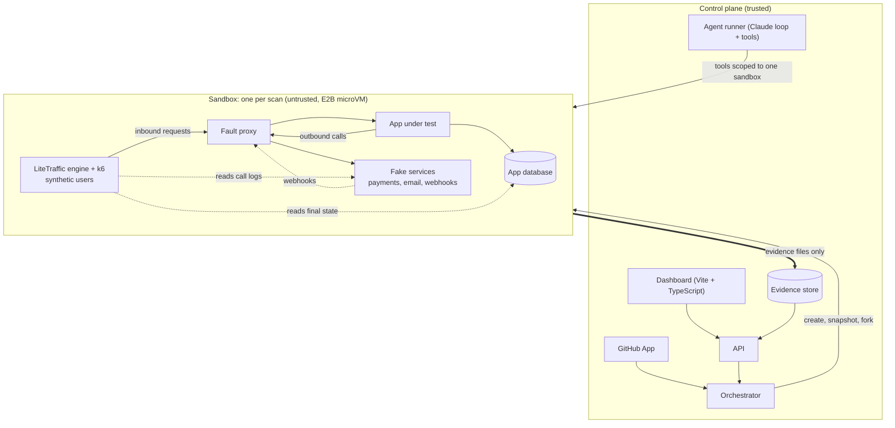

# Architecture

Status: proposed. Not built, not measured. See [open questions](./open-questions.md).

## Summary

Pledge is a control plane that runs one isolated sandbox per scan. Inside the sandbox sit
the customer's app, its database, fake third-party services, a fault proxy and the
LiteTraffic engine. Claude drives the sandbox from outside through a small set of tools.

Four design choices shape everything else:

- **Claude writes, code decides.** Claude authors scenarios, pledges and planted bugs. The
  verdict always comes from deterministic checks on the app's data, never from a model's
  opinion.
- **The agent stays outside the sandbox.** Customer code is untrusted. API keys, the GitHub
  token and the orchestrator never enter the machine that runs it.
- **Everything is a file.** Scenarios, pledges, fault plans and evidence are plain files in a
  run directory, so a human can review them and a coding agent can read them.
- **LiteTraffic stays the engine.** The open-source CLI keeps doing traffic, fixtures,
  assertions and reports. Pledge adds authoring, sandboxes, faults and proof on top.

## At a glance

The control plane sits outside, one sandbox per scan sits below it, and only evidence files
leave the sandbox.

Synthetic users reach the app through the fault proxy, and the app's calls to payment or
email providers go back through the same proxy to fakes. The engine reads the database and
the fakes' logs to decide whether each pledge was kept.

## Components

Twelve parts. The engine, its reports and the E2B target option already exist in the
open-source CLI. The rest is new.

| Component | Job | Technology | Status |
|---|---|---|---|
| GitHub App | Repo access with short-lived tokens, pull request comments | GitHub App | New |
| API | Repos, runs, pledges, findings and the live run stream | FastAPI (Python), database on the shared Postgres | Built: token sign-in, no orchestrator or GitHub App yet |
| Dashboard | The founder's view of scans, findings and pledge review | React, TanStack Router and Query, Tailwind, built with Vite | Built to the [dashboard design](./dashboard-design.md), except Coverage |
| Orchestrator | Queues scans, creates and forks sandboxes, enforces budgets and timeouts | Python job queue and workers | New |
| Agent runner | Runs the Claude loop and exposes tools that act on one sandbox | Python, Anthropic API with tool use | New |
| Sandbox | One isolated machine per scan | E2B (Firecracker microVM); Docker inside it works ([spikes](./spikes/phase-0.md)) | Exists as a target option |
| App under test | The customer's code and its database | The customer's stack | n/a |
| Fault proxy | Sits on the app's inbound and outbound calls. Retries, duplicates, delays and reorders on a seed | Small Python HTTP proxy | New |
| Fake services | Stand-ins for payments, email and webhooks that record every call | Small Python HTTP servers, generated per repo | New |
| LiteTraffic engine | Fixtures, seeded traffic through k6, observers, assertions, verdict, report | Python CLI plus k6 | Exists |
| Evidence store | Run directories: manifests, events, failing samples, reports | Object storage | New (local run folders exist) |
| CLI and agent skill | `pledge` commands for people and for coding agents | Wrapper around the engine | New |

Detail on the parts that carry the most design weight:
[agent runner](./agent-design.md), [sandbox, fault proxy and fakes](./sandbox-design.md),
[data model](./data-model.md).

### Frontend: Vite, not Next.js

The dashboard is a client-side single-page app built with Vite and TypeScript. It is static
files plus calls to the API, so:

- There is no server rendering and there are no framework API routes. Every endpoint lives
  in the API service.
- The dashboard holds no secrets. The GitHub token, Anthropic key and sandbox credentials
  stay behind the API.
- Reports are evidence files. The dashboard links to them or renders them from the API; it
  does not generate them.

## First-scan lifecycle

A first scan runs twelve steps. Step 5 is the one that makes the rest cheap: the booted app
is snapshotted once and every later run forks it.

1. **Connect.** The founder installs the GitHub App. Pledge gets a short-lived token for one
   repo.
2. **Clone.** The orchestrator creates a sandbox from the base template and clones the repo
   into it.
3. **Discover.** Claude reads the repo: stack, services, environment variables, migrations,
   routes, and every outbound call to a third party.
4. **Boot.** Claude installs dependencies, starts the database, runs migrations and starts
   the app. Third-party URLs are pointed at the fake services. It retries until a health
   check passes or the budget runs out.
5. **Snapshot.** The healthy sandbox is saved. Its boot recipe is stored against the commit.
6. **Seed.** Claude generates a realistic starting dataset, through the app's own API where
   it can.
7. **Author.** Claude writes scenarios (users and journeys) and pledges (a check on the data
   plus the value it must have).
8. **Baseline run.** Scenarios run with no faults. A pledge that breaks here is either a real
   bug or a wrong pledge, so it is flagged for human review.
9. **Prove.** For each pledge, Claude plants a bug in a fork. The pledge must break there. If
   it does not, it is marked unproven and cannot block a merge.
10. **Fault runs.** Forks run in parallel, each with its own seed and fault plan.
11. **Verdict.** The engine counts kept and broken per pledge across seeds and writes the
    evidence.
12. **Review.** The founder sees the report and approves the pledges that should become a
    pull request check.

## Pull request lifecycle

A pull request run skips steps 3 to 9. It rebuilds the snapshot from the stored recipe at
the new commit and reruns only the scenarios the diff touches. Authoring runs again only
when the diff adds routes or changes a file a pledge was derived from.

## Sources

- LiteTraffic site, for what the engine does today.
- E2B SDK reference, for snapshots, pausing and network control.
- Workers IO listing, for bring-your-own-cloud.
