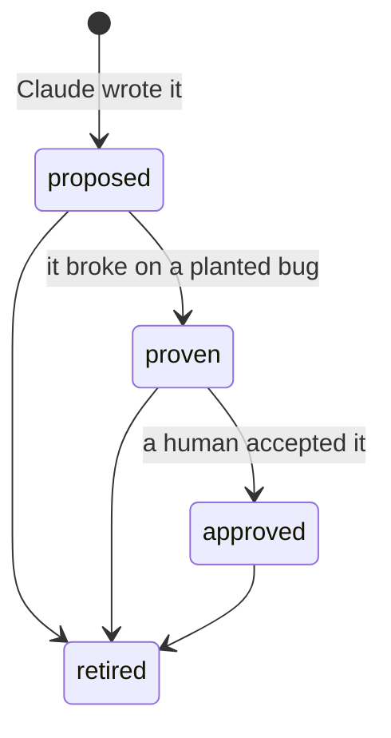

# Data model

Status: proposed.

Seven objects. Pledges and scenarios are files in the customer's repo so they can be
reviewed in a pull request, and run data is files in a run directory.

| Object | What it holds | Lives in |
|---|---|---|
| Repo profile | Stack, boot recipe, environment map, outbound calls, snapshot id, commit | Control plane |
| Pledge | Id, plain statement, the check (observer plus expected value), source, confidence, status | `.pledge/pledges/` in the repo |
| Scenario | The LiteTraffic manifest: actors, fixtures, schedule, assertions, budgets | `.pledge/scenarios/` in the repo |
| Fault plan | Seed and an ordered list of faults with their targets | Run directory |
| Run | Scenario digest, seed, fault plan, snapshot id, verdict | Run directory |
| Evidence | Event log, failing samples with expected and actual, proxy and fake-service logs, report, checksums | Run directory |
| Finding | A broken pledge, the seeds it broke on, the smallest fault plan that breaks it, a replay command | Report and pull request comment |

## File formats so far

Defined by hand in Phase 1 and validated by the `pledge` CLI. See the
[demo shop](../demo/shop) for one of each.

- **Pledge**, `.pledge/pledges/<id>.json`: `schema_version`, `id`, `statement`, `check`
  (`scenario` and `assertion`), `source`, `confidence`, `status`.
- **Faults**, `.pledge/faults/<name>.json`: a `faults` list. A run combines it with a seed
  into the fault plan the engine records.
- **Boot recipe**, `pledge.boot.json`: the services to start with their health checks, the
  proxy routes, the traffic target and the fakes to reset between runs. In the data model
  above this is part of the repo profile; in Phase 1 it is a file next to the app.

## Pledge states

Only **approved** pledges can fail a pull request. A pledge that did not break on its
planted bug stays unproven: it can appear in a report but cannot block a merge.

## Why pledges and scenarios live in the customer's repo

The team owns them, changes to them show up in code review, and the product keeps working
if they leave the hosted service and run the open-source CLI.
