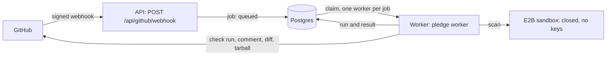

# The GitHub App and the pull request path

Status: built and tested against stand-ins. Not yet run against GitHub or E2B: the App does not
exist until the owner creates it with the settings below, and nothing here has started a sandbox.

Once the App exists, a pull request on an installed repository gets a check run named **Pledge**
and one comment that is edited in place on every push.

## 1. Create the App

GitHub → Settings → Developer settings → GitHub Apps → New GitHub App. Enter exactly this and
leave everything else at its default.

| Field | Value |
|---|---|
| GitHub App name | `Pledge` (must be unique across GitHub; `Pledge Checks` if taken) |
| Homepage URL | `https://pledge.sh` |
| Callback URL | empty |
| Request user authorization (OAuth) during installation | off |
| Webhook → Active | on |
| Webhook URL | `https://app.pledge.sh/api/github/webhook` |
| Webhook secret | a new random value: `openssl rand -hex 32`. Keep it for step 2 |
| Repository permissions → Checks | Read and write |
| Repository permissions → Pull requests | Read and write |
| Repository permissions → Contents | Read-only |
| Repository permissions → Metadata | Read-only (GitHub selects it for you) |
| Every other permission | No access |
| Subscribe to events | **Pull request**. Also **Installation** if the list offers it; GitHub sends installation events to every App whether or not it is listed |
| Where can this GitHub App be installed? | **Only on this account** (see [Who may install it](#who-may-install-it)) |

After creating it, on the App's page:

1. Note the **App ID** (a number).
2. **Generate a private key**. A `.pem` file downloads once. It is the App's identity; it goes into
   Dokploy in step 2 and nowhere else. Do not commit it and do not keep the download.

What each permission is for, so that none is granted on trust: Checks writes the check run; Pull
requests reads the diff and writes the comment; Contents downloads the repository at the pull
request's head commit; Metadata is required by GitHub for any App.

## 2. Secrets

All of them are runtime environment variables on Dokploy applications. None is in git, in a GitHub
Actions secret, or in an image.

| Variable | API (`api`) | Worker (`worker`) | What it is |
|---|---|---|---|
| `GITHUB_WEBHOOK_SECRET` | yes | no | The webhook secret from step 1. The API verifies every delivery with it |
| `GITHUB_APP_ID` | no | yes | The App ID |
| `GITHUB_APP_PRIVATE_KEY` | no | yes | The whole `.pem`, including the BEGIN and END lines. If the field takes one line only, replace each line break with the two characters `\n`; the worker turns them back |
| `E2B_API_KEY` | no | yes | Starts the sandboxes |
| `ANTHROPIC_API_KEY` | no | yes | Not read yet. It is for the phase that proposes pledges for a pull request, which is defined but not switched on. Leave it out until then |
| `DATABASE_URL` | already set | yes, the same value | The worker reads jobs from and writes runs to the API's database |
| `PLEDGE_PUBLIC_URL` | already set or default | optional | Base of the links in the comment. Default `https://app.pledge.sh` |

Each service holds only what it uses. The API never sees the App's private key, so a flaw in the
public-facing service cannot mint GitHub tokens. The worker never sees the webhook secret or the
dashboard's `PLEDGE_API_TOKEN`.

Both are opt-in:

- Without `GITHUB_WEBHOOK_SECRET` the API starts and serves everything as before, and the webhook
  answers 503. A deploy made before the secret exists does not fail.
- The worker refuses to start, naming what is missing, unless `DATABASE_URL`, `GITHUB_APP_ID`,
  `GITHUB_APP_PRIVATE_KEY` and `E2B_API_KEY` are all set. It is a separate application, so its
  failing to start affects nothing else.

## 3. Deploy the worker

The worker is the API's image with a different command. `scripts/deploy.mjs` does not know about it,
on purpose: adding it there as a required application would fail every deploy until the secrets
above exist.

In Dokploy, project `pledge`, add an application:

| Setting | Value |
|---|---|
| Name | `worker` |
| Source | Docker image `ghcr.io/rohansx/pledge-api:main` |
| Command | `pledge worker` |
| Domain, port | none. It listens on nothing |
| Replicas | 1. More is safe (a job is claimed by exactly one worker) but each scan already uses five sandboxes |
| Environment | the Worker column of the table above |

Because it tracks the `main` tag, redeploy it by hand in Dokploy after a merge that changes
`python/`. Until then it keeps running the previous build, which is safe: the job document is the
only contract between the two services.

To check it: the worker's log shows nothing until a job arrives, then one line when it claims a job
and one when it finishes. It never logs a webhook body, a token, or a sandbox's output.

## 4. Install it and connect a repository

1. On the App's page, **Install App**, and choose the repositories.
2. GitHub sends an `installation` delivery. The API creates a repo for each repository, with the id
   `owner-name`. App settings → Advanced → Recent Deliveries shows the delivery and the API's
   answer: 202 for a delivery it acted on, 204 for one it ignores (GitHub's first `ping` is one),
   401 if the secret does not match.
3. A pull request scan needs three things that a first scan produces. Without them the check is
   neutral and nothing is tested:
   - the repository's `.pledge/` directory and `pledge.boot.json`, **committed to the repository**.
     The worker reads scenarios, pledges and fault plans from the pull request's own tree;
   - the repo's snapshot, which `pledge author APP_DIR --out DIR --publish --app owner/name` saves
     on the repo. The `--app` value must be the repository's full name: that is how a repo
     published from a laptop and the repository GitHub reports become the same repo;
   - at least one pledge approved in the dashboard, or the check can only ever be neutral.

## What a pull request gets

| Situation | Check run | Comment |
|---|---|---|
| An approved pledge broke | **failure** | The broken pledges, each with a link to its finding |
| Pledges broke but none is approved, or nothing broke | **neutral**, with the summary | The same summary |
| The diff touches no scenario (documentation, tests) | **neutral**: "No scenario is touched by this change" | none |
| The repository has no `.pledge/scenarios` | **neutral**, saying to run a first scan | none |
| The pull request comes from a fork | **neutral**: "Not run: pull request from a fork" | none |
| Anything failed: GitHub, E2B, the app would not boot | **neutral**: "Pledge could not run" | none |

A neutral check does not block a merge, even as a required check. Only a failure does, and only an
approved pledge can cause one. The reason a job failed is shown in the dashboard's job list
(`GET /api/repos/{id}/jobs`), not in the check, because a check on a public repository is public
and the reason can quote the app's own output.

Which scenarios run is decided by code, not by a model (`python/pledge/pr.py`): a scenario runs
when the diff changes its own files, a file whose path names a route its journeys call, or a line
naming such a route. If a changed file matches nothing and is not documentation or a test, every
scenario runs. Each scenario runs under each fault plan that targets one of its routes, five seeds
each, at most four scans per pull request.

A new push to a pull request replaces a job that is still waiting. The same commit is never
scanned twice. A job whose worker died is picked up once more after an hour, then marked failed.

## Security

The webhook is the only route that writes without the bearer token.

- **The signature is the sign-in.** `X-Hub-Signature-256` is checked, in constant time, over the
  exact bytes received, before any of them is parsed. No secret configured means closed (503), not
  open. A body over 2 MB is refused whether or not it declares its length.
- **Only validated fields are stored.** A job holds the repository's full name and id, the
  installation id, the pull request number and two commit ids, each matched against a strict
  pattern. Nothing else from a delivery is kept, and no delivery is logged.
- **A repository cannot attach itself to another's repo.** Repos are bound to GitHub's numeric
  repository id. Two full names can produce the same `owner-name` id; the second is refused, not
  merged. A repo published from the command line is claimed only by the repository whose full name
  it was published under.
- **Tokens are short and narrow.** The worker signs a ten-minute App token and trades it for an
  installation token that lasts an hour and is limited to the one repository of the job. Neither
  is stored or logged, and error messages carry GitHub's status, never a token.
- **The sandbox holds no keys.** The pull request's code runs in an E2B sandbox with outbound
  access closed. The GitHub token, the App key, the E2B key and the Anthropic key stay in the
  worker's process. The tree is unpacked with path, link and device entries that leave the
  directory refused, and deleted when the job ends.
- **A pull request cannot approve its own pledge.** A pledge first seen in a pull request is stored
  as proposed whatever its file says. A pledge the dashboard already knows keeps the status decided
  there.

### Pull requests from forks

Not run. The worker posts a neutral check saying so and does not download the fork's tree or its
diff. On a public repository anyone can open a pull request, so running a fork would let a
stranger spend sandbox time, and later model tokens, at will, and would feed a stranger's diff and
description to the phase that writes pledges. No secret would leak if it did run (the sandbox is
closed and holds none), so this is a cost and abuse limit, not a confidentiality one. The honest
next step is the one CI systems use: run a fork's pull request only after a maintainer approves it.

### Who may install it

Keep the App installable **only on this account** until the dashboard has per-customer sign-in.
Today one shared token sees every repo, so a stranger who installed a public App would have their
repository's jobs and results appear in the owner's dashboard, and would spend the owner's E2B
account on every pull request.

## What "boot at this commit" does, and what it still needs

The snapshot a repo has is the app as it ran at the commit it was authored on. A pull request is
another commit. The worker (`scan_report` in `python/pledge/worker.py`, `boot_at_commit` in
`python/pledge/scan.py`) takes the cheapest path that still tests the pull request's code:

1. Restore the snapshot. Dependencies, database and fakes are already there.
2. Stop the app, lay the pull request's tree over `/work/app`, delete the files the pull request
   deletes, and start the app again from `pledge.boot.json`.
3. Check that it answers through the proxy. If any of that fails, boot the tree from cold in a
   fresh sandbox. If that fails too, the check says Pledge could not run.

Tested with stand-ins for the sandbox. Known gaps, none of which can pass silently (each ends in
"could not run", never in a result for the wrong code):

- **Nothing is installed.** Outbound is closed, so a pull request that changes a lockfile restarts
  on the old dependencies or does not restart. The cold boot has the same limit and so only works
  for an app whose dependencies are in the base template. The fix is a boot recipe that records its
  install steps, replayed with package registries open before the network is closed.
- **Builds run only if the recipe runs them.** A compiled or bundled app (Next.js, Go) restarts on
  its old build unless the recipe's start command builds first.
- **Changes the boot agent made to the app's own source are lost.** Authoring sometimes edits a
  source file to get an app booting (the umami run left a `layout.tsx.orig`). The tree laid over
  the snapshot is the repository's, so that edit is gone. Such edits need to be recorded as a patch
  in `.pledge/` and reapplied.
- **The snapshot ages.** Nothing rebuilds it when the default branch moves, so restarts get slower
  and less likely to work as the two commits drift apart.
