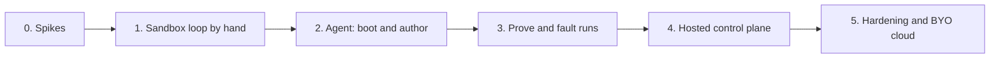

# Plan and phases

Status: draft. The technical overview describes the design but not a build order. This
sequencing is derived from it and has not been agreed. It carries no dates or estimates
because nothing has been measured yet.

## Ordering principle

Build inside-out. The sandbox loop (app, proxy, fakes, engine, verdict) is the product; the
agent automates writing its inputs; the hosted control plane wraps both. Each phase is
usable on its own and each one answers [open questions](./open-questions.md) that could
invalidate the phase after it.

## Phase 0: Spikes

Answer the questions that decide whether the sandbox design holds at all. Throwaway code.

- Run Docker Compose inside an E2B sandbox (Q-1).
- Snapshot a sandbox with a loaded Postgres, fork it, time the fork, read the storage bill
  (Q-2).
- Close outbound network after install and confirm the app can still reach in-sandbox
  services.
- Take one SDK that hard-codes its provider address and try to redirect it (Q-4).

**Exit:** a written answer to Q-1, Q-2 and Q-4, and a decision on native services versus
containers in the base template.

## Phase 1: Sandbox loop by hand

One known app, hand-written inputs, no Claude. Proves the engine-plus-faults loop finds a
real bug.

- Base template for one stack (Node or Python, plus Postgres and Redis) with k6, the
  LiteTraffic engine and a process supervisor.
- Fault proxy with the first faults: retry, duplicate delivery, same-instant requests.
- Hand-written fakes for the two or three providers the first design partners use.
- Hand-written scenarios and pledges in `.pledge/`; pledge file format defined.
- Run directory layout: fault plan, run, evidence (see [data model](./data-model.md)).
- `pledge` CLI wrapping the engine: run a scenario with a fault plan against a sandbox.

**Exit:** on a demo app with a known double-charge bug, the pledge breaks under the retry
fault and is kept on the fixed version. Evidence shows expected and actual.

## Phase 2: Agent, discover, boot and author

Claude produces what phase 1 wrote by hand.

- Agent runner with the six tools, scoped to one sandbox.
- Discover and boot phase, ending in a boot recipe and a snapshot.
- Seed step.
- Author phase, with every manifest passing the engine's inspect step before use.
- Per-phase budgets on tokens, wall-clock time and command count.
- Baseline run with no faults; broken pledges flagged for review.
- Instrumentation: boot success rate by stack, tokens per phase.

**Exit:** on repos Claude has not seen, a first scan reaches a baseline run without human
edits to the boot recipe. Boot success rate is measured, whatever it turns out to be.

## Phase 3: Prove and fault runs

The part that makes a pledge trustworthy and a finding actionable.

- Prove phase: planted bug as a patch in a fork, pledge must break.
- Parallel fault runs across forks, adaptive seeds, verdict as a count.
- Remaining faults: reorder, delay, restart.
- Explain phase: plain-language finding, minimal fault plan, replay command.
- Shrinking a failing fault plan (Q-7).
- Measure flake rate on clean apps (Q-6) and review planted bugs for realism (Q-8).
- Instrumentation: share of pledges proven, share of findings that reproduce on rerun.

**Exit:** a first scan runs all twelve lifecycle steps from the CLI and produces a report
whose findings replay.

## Phase 4: Hosted control plane

Everything up to here runs from a laptop. This phase makes it a service.

- GitHub App with short-lived, single-repo tokens.
- Orchestrator: queue, sandbox create and fork, budgets, timeouts.
- API and dashboard: accounts, scans, run history, report links.
- Evidence store on object storage, one prefix per customer.
- Pledge approval flow; approved pledges become a pull request check.
- Pull request runs: snapshot rebuilt from the stored recipe, diff-scoped scenarios.
- Instrumentation: sandbox minutes per run, share of pledges approved.

**Exit:** a design partner installs the GitHub App, approves pledges from a first scan, and
gets a pull request comment on their next change.

## Phase 5: Hardening and bring-your-own-cloud

- Customer-set deletion schedule for sandboxes and snapshots.
- Redaction extended to proxy and fake-service logs.
- Security page, including source code sent to the Anthropic API.
- Runs inside the customer's own E2B or cloud account.
- More stack templates; non-HTTP dependencies if Q-3 says they matter.
- Pricing, from the metrics collected in phases 2 to 4.

## Decisions still to make

The overview leaves these open, so the plan does not assume them:

- Language and framework for the new components (orchestrator, agent runner, fault proxy,
  API). The engine is Python.
- Which stack the first base template supports.
- Which providers get the first hand-written fakes. This needs the design partners named.
- Whether the engine is vendored, pinned as a dependency, or developed in this repository.
- Where the open-source boundary sits between the `pledge` CLI and the hosted service.
